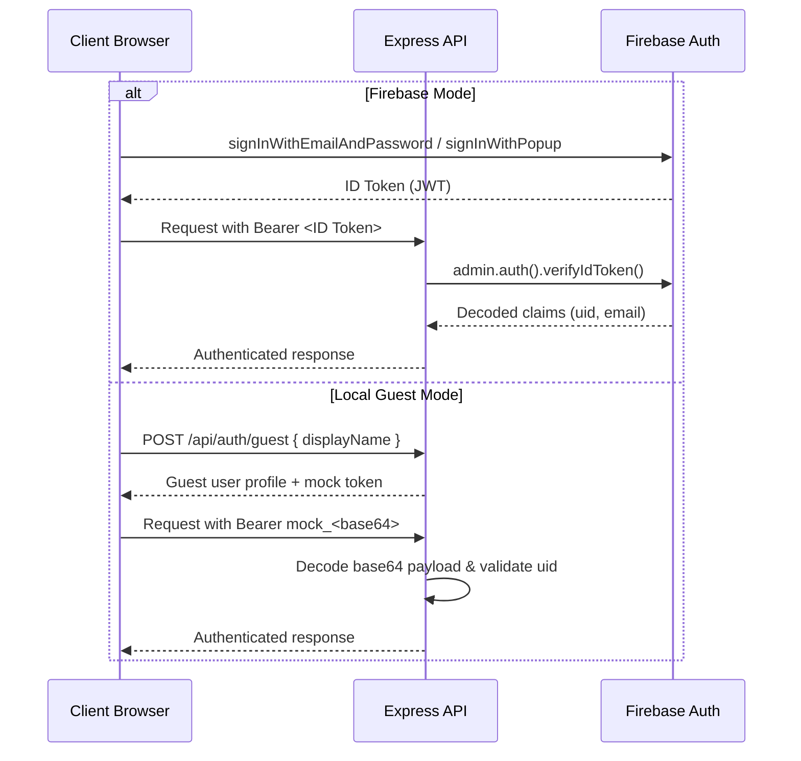

# HiveTalk Authentication Architecture

HiveTalk features an adaptable **dual-mode authentication engine** designed for instant zero-config local testing while seamlessly scaling to enterprise Firebase Authentication in production.

---

## 1. Authentication Modes

### Mode A: Firebase Authentication (Cloud Mode)
- **Engine**: Firebase Auth (Email/Password, Google OAuth).
- **Token**: Standard Firebase JSON Web Token (JWT) signed by Google.
- **Verification**: Verified on the backend via Firebase Admin SDK (`auth.verifyIdToken(token)`).
- **Activation**: Automatically activates when `VITE_FIREBASE_API_KEY` and project configurations are supplied in `.env`.

### Mode B: Local Guest Session (Offline/Development Mode)
- **Engine**: Local token issuer & browser storage.
- **Token**: Encoded bearer token format: `mock_<base64_payload>`.
- **Verification**: Decoded on the server via `server/src/middleware/authMiddleware.ts`.
- **Activation**: Default fallback when Firebase credentials are not populated or in offline mode. Enables testing and running the app immediately with zero external dependencies.

---

## 2. Authentication Flow



---

## 3. Session Persistence

In the browser, the current user session is persisted under the key:
```typescript
localStorage.getItem('hivetalk_user');
```
Upon application load, `useAuth` checks for an existing Firebase session; if unconfigured, it restores the local guest identity.
