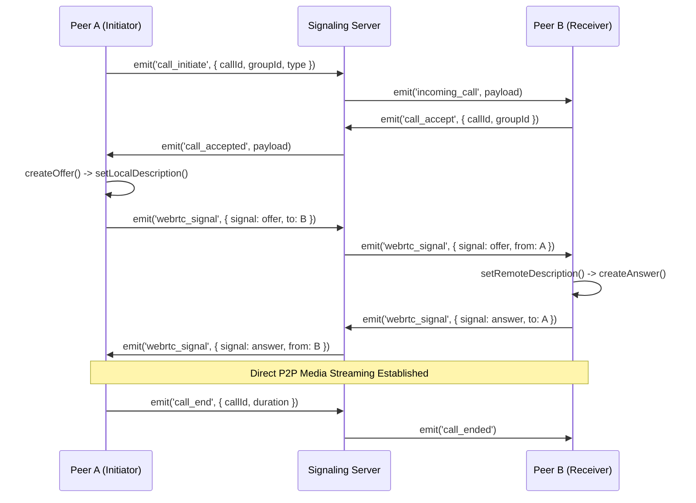

# WebRTC Audio & Video Calling Architecture

HiveTalk supports high-fidelity 1-on-1 and group voice and video calling powered by WebRTC with Socket.IO signaling.

---

## 1. Call Lifecycle



---

## 2. ICE Servers & STUN/TURN Configuration

Default STUN servers are configured in `client/src/config/appconfig.ts`:
```typescript
iceServers: [
  { urls: 'stun:stun.l.google.com:19302' },
  { urls: 'stun:stun1.l.google.com:19302' },
  { urls: 'stun:stun2.l.google.com:19302' }
]
```
For production enterprise firewalls and symmetric NATs, a TURN server (e.g. coturn or Twilio Network Traversal Service) can be provided via environment variables.

---

## 3. Supported Calling Features
- **Mute / Unmute**: Track-level enabling and disabling via `audioTrack.enabled = !audioTrack.enabled`.
- **Camera Toggle**: Front and rear cameras switching or turning off video track.
- **Screen Sharing**: `navigator.mediaDevices.getDisplayMedia({ video: true, audio: true })`.
- **Call Duration Counter**: Real-time timer synced across participants.
